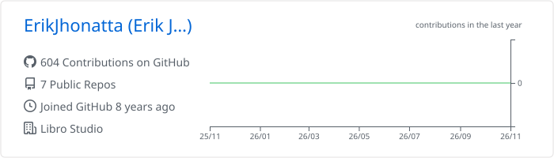
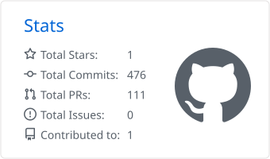
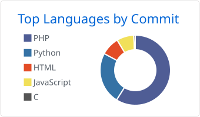

<div align="center">


<p>
  <a href="https://www.linkedin.com/in/erikjhonatta/"></a>
  
  
</p>

</div>

I build the screens people actually click on: Angular apps backed by a design system, where a component gets written once and reused everywhere. Outside work I like the other end of the stack too, the part where bytes turn into opcodes and sensor data turns into geometry.

```ts
const erik = {
  role:      "Frontend Developer @ Libro Studio",
  degree:    "B.Sc. Computer Science @ UFAPE",
  dayToDay:  ["Angular", "TypeScript", "Design Systems", "UI that holds up in production"],
  sideQuests:["6502 disassemblers", "compilers", "3D scanning with an iPhone LiDAR"],
  believes:  "a good component library beats a hundred one-off screens",
  askMeAbout:["Angular architecture", "design tokens", "why the NES is still fun to reverse"],
} as const;
```

## 🔭 Building now

**LidarHouse** 🔒 *(private, for now)*: scan a house with the iPhone's LiDAR and watch the mesh appear **live in the browser on your PC**. It turns the scan into a photo-coloured 3D model, a floor plan with measurements, a printable dollhouse and CAD / 3D-print / AR exports.

```
iPhone (ARKit mesh + depth + RoomPlan)
   │  binary WebSocket over Wi-Fi, PC found via Bonjour
   ▼
Python (FastAPI · Open3D · trimesh)  →  Browser (Three.js): live 3D, floor plan, exports
```

## 🧪 Things I've built

| Project | What it is | Stack |
|---|---|---|
| [**NES-Disassembler**](https://github.com/ErikJhonatta/NES-Disassembler) | Feed it a `.nes` ROM and it turns 6502 machine code back into readable assembly |  |
| [**Compiladores**](https://github.com/ErikJhonatta/Compiladores) | A compiler for an LL(1) language of my own: functions, procedures, `while`, `if/else`, `break`/`continue` |  |
| [**olhaeleaebot**](https://github.com/ErikJhonatta/olhaeleaebot) | A Discord bot that joins your voice channel just to play one meme sound |  |

## 🧰 Toolbox

<p align="center">
  <b>Daily</b><br/>
  
</p>
<p align="center">
  <b>Also comfortable with</b><br/>
  
</p>

## 📊 GitHub stats

<div align="center">

<picture>
  <source media="(prefers-color-scheme: dark)" srcset="https://raw.githubusercontent.com/ErikJhonatta/erikjhonatta/master/profile-summary-card-output/github_dark/0-profile-details.svg" />
  
</picture>

<picture>
  <source media="(prefers-color-scheme: dark)" srcset="https://raw.githubusercontent.com/ErikJhonatta/erikjhonatta/master/profile-summary-card-output/github_dark/3-stats.svg" />
  
</picture>
<picture>
  <source media="(prefers-color-scheme: dark)" srcset="https://raw.githubusercontent.com/ErikJhonatta/erikjhonatta/master/profile-summary-card-output/github_dark/2-most-commit-language.svg" />
  
</picture>

<br/><br/>

<picture>
  <source media="(prefers-color-scheme: dark)" srcset="https://raw.githubusercontent.com/ErikJhonatta/erikjhonatta/output/github-snake-dark.svg" />
  
</picture>

</div>
